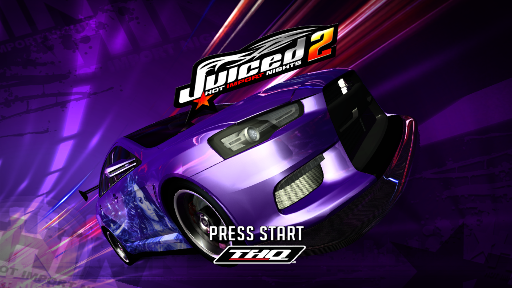
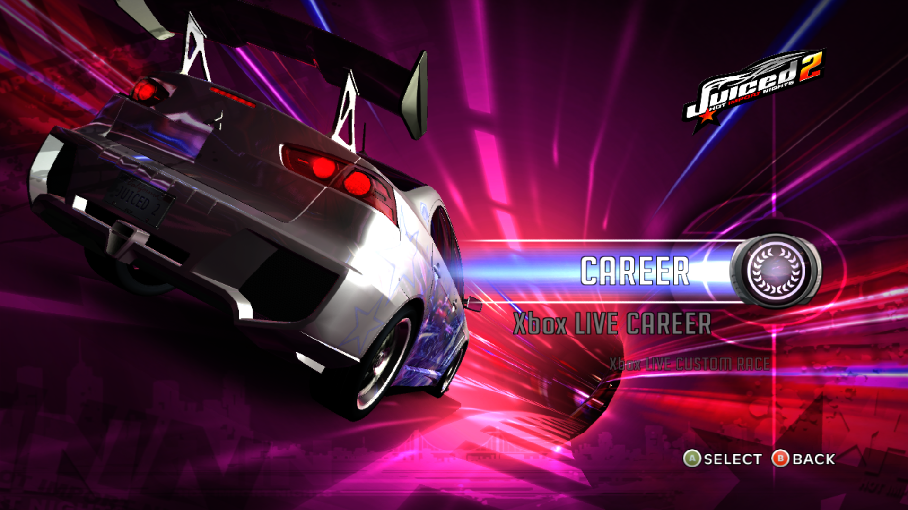
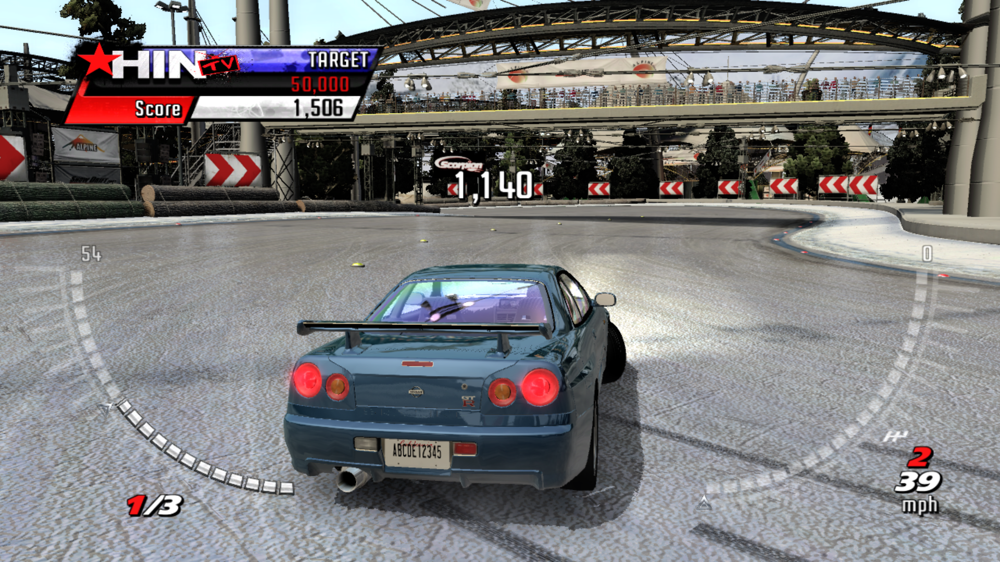
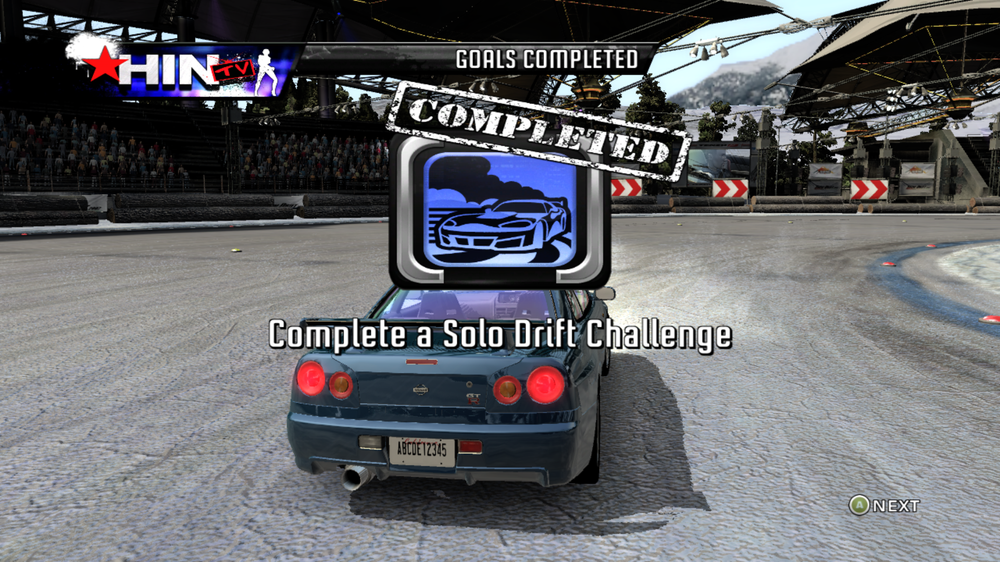
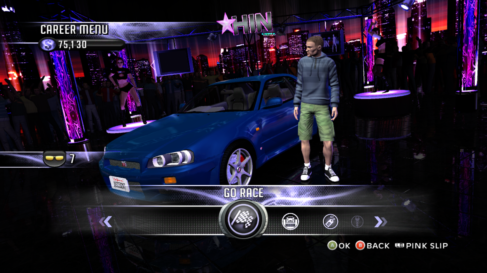

# Juiced 2: Hot Import Nights Recompiled

> **EARLY PREVIEW. THIS IS NOT A RELEASE-READY BUILD.** The game starts, plays and saves, and I have played Career from the rookie league through league 7. But it has known graphics problems: random missing or wrongly drawn parts on cars and characters, short black-screen flickers at some screen changes, and lag with many cars on screen. Handling can also feel off when the frame rate varies (the same handling issues prevalent in the PC version when making framerates higher). Please read "Known issues" below before you try it. These problems are being worked on.

A native Windows port of THQ's Juiced 2: Hot Import Nights for the Xbox 360, made with static recompilation via the ReXGlue SDK.

> Unofficial fan project. Not affiliated with or endorsed by THQ, THQ Nordic, Juice Games or any other owner of the game. All trademarks belong to their owners. This repository contains no game files and no game code. The screenshots show artwork and logos owned by their respective owners, for identification only. You need your own legally obtained copy of the game. Requests for or links to game files will be removed.

## What this is

This repository holds the pieces that make the ReXGlue SDK work with Juiced 2: the fix list that lets the recompiler find every function in the game, a small launcher program, and a set of patches to the SDK:

- `codegen_vector_alias.patch`: fixes a code-generation bug where one vector instruction could overwrite its own input.
- `texture_mip_layout.patch`: corrects how the smaller mip levels of some textures are located in memory.
- `xmp_music.patch`: adds music playback (the SDK does not play the game's music playlist on its own).

The launcher program (`src/`) also contains a workaround for a crash caused by the game releasing memory too early, hides the mouse pointer, takes the window icon from your own copy of the game, and writes a crash report to `juiced2_crash.txt` next to the game if it crashes. The game itself is translated on your own computer from your own copy.

## Screenshots

Taken from the running port.

## Status

Works:
- Boots, menus, Career (played from the rookie league through league 7, including the league progression events), saving and loading, achievements
- Music in the menus and during races
- Keyboard input

Known issues:
- **Random graphics corruption.** Parts of a scene can be drawn badly or not at all. When you enter the garage from the Career menu, the pole dancers in the club scene can be badly scrambled, large parts of the scene can be black and the car can be cut off, while the same screen looks fine when you return to it after an event. Cars can also show missing pieces: a door, hood, bumper or headlights. It is random and most often happens on the first Career load after starting the game. Quitting and starting the game again often gives a clean run (but not always). The cause has not been found yet.
- **Short black flickers** at some screen changes: after pressing A on Career, on the Driver DNA Lab, and after crossing the finish line on the last lap.
- **Lag with many cars on screen**, likely due to how many graphics are being rendered.
- **Handling and acceleration can feel off** when the frame rate drops or is uneven. The cause is still being investigated.
- A loud audio burst can happen at the start of a race.
- The game crashes at the title screen when it runs on AMD Radeon integrated graphics (the only other graphics chip tested). On laptops with two graphics chips, Windows can pick the integrated one by default, so setup asks Windows to run the game on the high-performance chip (Settings, System, Display, Graphics). If it still crashes at the title screen, check that setting for `juiced2.exe`.
- The first time you reach a new screen or track, there can be a short stutter while graphics shaders are prepared and saved.
- Not tested: split-screen, downloadable content, and the end of Career.
- Online features do not work.

## Tested on

- Laptop: AMD Ryzen 7 7735HS, NVIDIA GeForce RTX 4060 Laptop GPU (driver 32.0.16.1062), 32 GB RAM, Windows 10 Home. This is the only PC it has been tested on.

## What you need

- Windows 10 or 11, 64-bit (only Windows 10 has been tested), and a graphics card that supports Direct3D 12
- About 10 GB of free disk space for the build, plus room for your extracted game files
- An internet connection for the first setup (it downloads the ReXGlue SDK and its libraries)
- Your own copy of Juiced 2: Hot Import Nights for Xbox 360 (Title ID 545107D5), extracted so that `default.xex` and the game's other files sit in one folder. Extract your game's disc image with a tool such as Xbox Image Browser. The supported `default.xex` is 5,349,376 bytes with the SHA-256 hash `AE20F2467CC0535872B18517941AC4434F60408CB6D07BF47DA799CE1564E574`. Other releases are not supported, and setup warns you if yours is different.
- Visual Studio 2022 Community (free), with these parts ticked in the Visual Studio Installer: "Desktop development with C++", "C++ Clang Compiler for Windows" and "C++ CMake tools for Windows". The Build Tools edition and other Visual Studio versions have not been tested.
- Git for Windows

## Setup

This is an early version, tested so far on one PC (see "Tested on" above). Reports from other PCs, good or bad, are welcome: please [open an issue](https://github.com/anishchandra24/Juiced2-Recompiled/issues/new/choose).

### Easy install (recommended)

1. Download `Juiced2-Recompiled-Setup.exe` from the [Releases page](https://github.com/anishchandra24/Juiced2-Recompiled/releases).
2. Run it. Windows may show "Windows protected your PC" because the program is not code-signed. Click "More info", then "Run anyway". You can check your download against the SHA-256 fingerprint in the release notes.
3. Click "Browse..." next to "Your game folder" and choose the folder that contains `default.xex`. Keep the suggested install folder or choose another short path, then click "Install".
4. Wait. If Git or Visual Studio 2022 Community are missing, the program installs them with Windows' package installer (Windows asks for permission), then downloads the project and builds the game. Allow 15 to 30 minutes, plus the downloads and any Visual Studio install.
5. When it says it is done, click "Play", or use the "Juiced 2 Recompiled" shortcut on your desktop.

To remove it, use Settings, Apps, "Juiced 2 Recompiled" (or the "Uninstall" button in the setup program). Uninstalling never touches your game files, and it asks before deleting your saves.

Automatic installation of Visual Studio has not been tested on a PC that does not have it. If you try it, please open an issue and tell me how it went, whether it worked or not. If it fails, install the tools by hand (see "What you need") and run the setup program again.

### Manual install

If you prefer to do it by hand, or the setup program does not work for you:

1. Install the tools listed above.
2. Download this project into a short folder path (long paths can break the build). Open a command prompt and run:

        git clone https://github.com/anishchandra24/Juiced2-Recompiled.git C:\Juiced2

3. Open the `C:\Juiced2` folder and double-click `setup.bat`. When it asks, type the path to your extracted game folder (the folder that contains `default.xex`) and press Enter.
4. Wait. Setup checks your tools and game files, downloads the ReXGlue SDK at the exact version this project uses, applies the patches, builds the SDK, generates the game's code from your `default.xex`, builds the game, and creates a desktop shortcut. Allow 15 to 30 minutes, plus the downloads.
5. Start the game from the "Juiced 2 Recompiled" shortcut on your desktop, or run `dist\Launch Juiced 2.bat`.

Notes:

- If Windows Firewall asks about `juiced2.exe`, you can click Cancel. The game does not need network access to run (online features are not supported).
- If setup stops, it prints what went wrong. Fix the problem and run `setup.bat` again; finished steps are skipped. Detailed logs are in `.local\logs`.
- Options: run `setup.bat -NoShortcut` for no desktop shortcut, `setup.bat -SkipIcon` to skip the game's icon, or `setup.bat -Rebuild` to rebuild the SDK from scratch.
- The game's icon is made from your own copy of the game during setup. For that, the game window opens for a few seconds and closes by itself. This is expected. The icon is not part of this repository.
- Setup creates a folder named `assets` inside the project. It is a link to your game folder, not a copy. Before deleting the project folder by hand, open a command prompt in it and run `rmdir assets`, so your game files are not touched. The uninstaller does this for you.
- Saves, settings and achievements are stored in `Documents\juiced2`, not in the project folder. Back this folder up before trying new builds.
## Reporting problems and test results

Found a bug, or hit a problem during setup? Please [open an issue](https://github.com/anishchandra24/Juiced2-Recompiled/issues/new/choose). Test reports are just as welcome as bug reports, including "it worked": this project has only been tested on one PC, so every report helps. Useful things to include are your Windows version, your CPU, graphics card and driver version, RAM, whether setup finished, and the last lines of the logs. The setup steps log to `.local\logs`, and if the game crashes it writes `dist\juiced2_crash.txt`.

Please do not post or link game files. Requests for game files will be removed.

## Controls (keyboard)

Keyboard mode is on in the launchers (`mnk_mode`). Defaults:
- Start: Enter or X
- A: Space or ;  B: Backspace or '  X: L  Y: P
- Left stick: W A S D   Right stick: arrow keys
- Triggers: Q / E (or I / O)   Shoulders: 1 and 3
- Back: Tab or Z
- F3 shows performance info, F4 shows settings

## How this was made

This project was developed in a chat conversation with Claude, an AI assistant by Anthropic. Claude wrote the diagnostic commands, configuration fixes, code and patches. Claude had no access to the developer's computer: everything it wrote was copied in by hand, run and tested by me, the project owner (anishchandra24), who also reported what happened, supplied knowledge of the original game, and made all decisions. It has been tested by me on one PC (see "Tested on" above) and has not been reviewed by anyone else.

## Credits

- anishchandra24: project, fixes and testing
- The ReXGlue SDK by Tom Clay and contributors
- The Xenia project (Ben Vanik and contributors), whose work the SDK's graphics code builds on
- Claude (Anthropic): AI assistant used to write code, patches and diagnostics (see "How this was made")

## License

The files in this repository are released under the GNU General Public License v3.0 (see LICENSE). The license covers only what this project is entitled to license. It grants no rights to the game's files, or to anything generated from them on your own computer. The screenshots show artwork and logos owned by their respective owners and are not covered by this license. The patches modify code from the ReXGlue SDK and Xenia, which keep their own BSD licenses (see THIRD_PARTY_NOTICES.md).